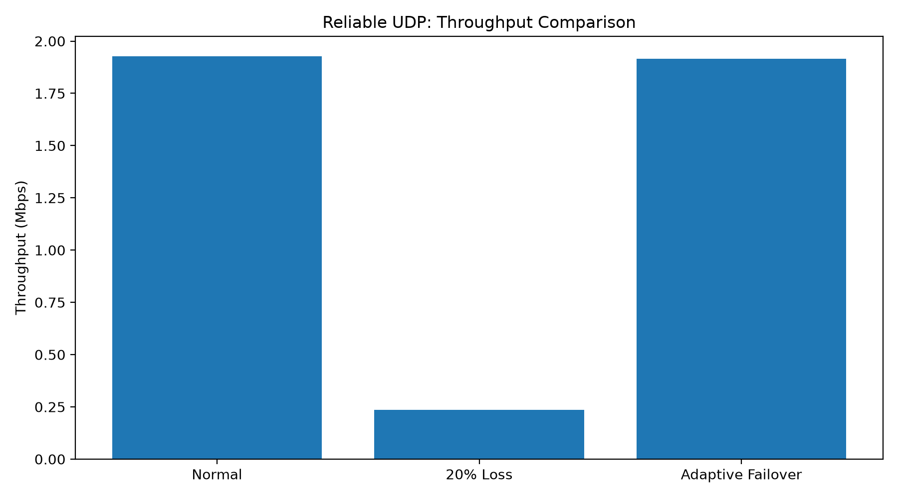
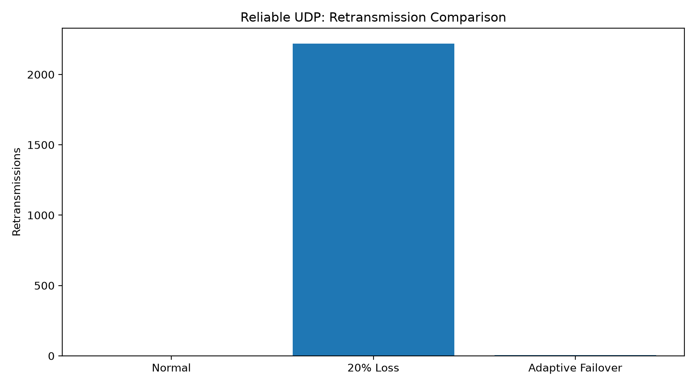
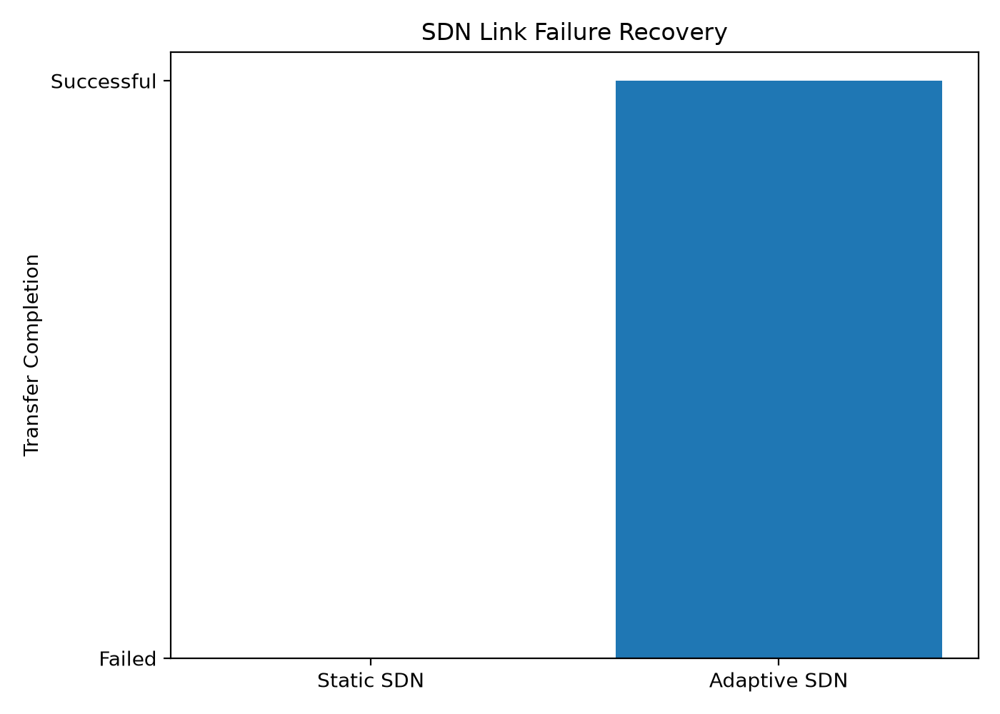

# Testing and Performance Evaluation

## Reliable UDP File Transfer with SDN-Based Adaptive Rerouting

### 1. Objective

The objective of testing is to evaluate the reliability, correctness, fault tolerance, concurrency, and performance of the Reliable UDP File Transfer system integrated with Software-Defined Networking (SDN).

The system is tested under normal network conditions, simulated packet loss, primary-link failure, concurrent client communication, and static forwarding.

The experiments demonstrate how application-layer UDP reliability and adaptive SDN rerouting contribute to successful file transfers.

## 2. Testing Environment

| Component | Configuration |
|---|---|
| Operating System | Ubuntu Linux (WSL2) |
| Programming Language | Python 3 |
| Network Emulator | Mininet |
| Virtual Switch | Open vSwitch |
| SDN Controller | OS-Ken |
| SDN Protocol | OpenFlow 1.3 |
| Transport Protocol | UDP |
| Sender | H1 (`10.0.0.1`) |
| Receiver | H2 (`10.0.0.2`) |
| Receiver Port | 5001 |
| Switches | S1, S2, S3, S4 |
| File Size | 10 MiB (10,485,760 bytes) |
| UDP Payload Size | 1,200 bytes |
| Sliding Window Size | 16 packets |
| Retransmission Timeout | 0.5 seconds |
| Maximum Retries | 20 |
| Integrity Verification | SHA-256 |

The normal, packet-loss, and failover experiments used a 2 Mbps bandwidth restriction on the sender. The concurrent-client experiment was performed without this restriction.

## 3. Network Topology

The network consists of two hosts and four OpenFlow switches.

**Primary path:**

H1 → S1 → S2 → S4 → H2

**Backup path:**

H1 → S1 → S3 → S4 → H2

The OS-Ken controller manages switch forwarding rules using OpenFlow 1.3.

In adaptive mode, the controller detects failure of the S2–S4 link and switches traffic to the backup route.

In static mode, forwarding rules are not automatically updated following this failure.

## 4. Testing Methodology

Testing was automated using `experiment.py`.

The experiment runner performs the following operations:

1. Creates the Mininet network topology.
2. Configures the selected SDN controller mode.
3. Starts the UDP receiver.
4. Starts one or more UDP senders.
5. Applies the selected testing condition.
6. Records transfer duration, throughput, retransmissions, and packet counts.
7. Checks whether the file transfer completed successfully.
8. Records SHA-256 verification status.
9. Saves experiment logs and metrics.

Experiments were executed separately to compare the system under different conditions.

## 5. Test Cases

### TC01 — Normal UDP File Transfer

**Objective:** Verify successful end-to-end UDP file transfer under normal network conditions.

**Command:**

```bash
sudo /usr/bin/python3 -u experiment.py --scenario normal --mode adaptive
```

**Expected Result:**

The file transfers successfully through the primary network path and passes SHA-256 verification.

**Actual Result:**

| Metric | Value |
|---|---|
| File Size | 10 MiB |
| Total Packets | 8,739 |
| Transfer Time | 43.5267 seconds |
| Throughput | 1.9272 Mbps |
| Retransmissions | 0 |
| SHA-256 Verified | Yes |
| Status | PASS |

**Observation:** The application completed the transfer without retransmissions and achieved throughput close to the configured 2 Mbps bandwidth limit.

### TC02 — UDP Transfer Under 20% Packet Loss

**Objective:** Verify whether the application can recover from simulated packet loss.

**Command:**

```bash
sudo /usr/bin/python3 -u experiment.py --scenario loss20 --mode adaptive --timeout 900
```

**Expected Result:**

The sender retransmits unacknowledged packets, and the receiver reconstructs the complete file with successful SHA-256 verification.

**Actual Result:**

| Metric | Value |
|---|---|
| File Size | 10 MiB |
| Total Packets | 8,739 |
| Simulated Packet Loss | 20% |
| Transfer Time | 356.927 seconds |
| Throughput | 0.235 Mbps |
| Retransmissions | 2,219 |
| SHA-256 Verified | Yes |
| Status | PASS |

**Observation:** The system successfully transferred the complete file despite substantial packet loss. Retransmissions and timeout delays increased transfer duration and reduced throughput.

### TC03 — Adaptive SDN Link-Failure Recovery

**Objective:** Verify automatic rerouting when the primary network link fails during file transfer.

**Command:**

```bash
sudo /usr/bin/python3 -u experiment.py --scenario failover --mode adaptive --fail-after 4
```

**Expected Result:**

The controller detects the S2–S4 link failure and redirects traffic through S3, allowing the file transfer to complete.

**Actual Result:**

| Metric | Value |
|---|---|
| File Size | 10 MiB |
| Total Packets | 8,739 |
| Link Failure Triggered | Yes |
| Transfer Time | 43.7384 seconds |
| Throughput | 1.9179 Mbps |
| Retransmissions | 2 |
| SHA-256 Verified | Yes |
| Status | PASS |

**Observation:** Adaptive SDN successfully recovered from the primary-link failure. The file transfer completed with only two retransmissions.

### TC04 — Concurrent UDP Clients

**Objective:** Verify whether the receiver can support multiple simultaneous file-transfer sessions.

**Command:**

```bash
sudo /usr/bin/python3 -u experiment.py --scenario concurrent --mode adaptive
```

**Expected Result:**

Two senders simultaneously transfer files to the receiver, and both files pass integrity verification.

**Actual Result:**

| Metric | Value |
|---|---|
| Number of Clients | 2 |
| Total Data Transferred | 20 MiB |
| Total Packets | 17,478 |
| Reported Transfer Duration | 0.7368 seconds |
| Aggregate Throughput | 227.7038 Mbps |
| Retransmissions | 0 |
| SHA-256 Verified | Yes, both transfers |
| Status | PASS |

**Observation:** The receiver successfully handled two simultaneous transfer sessions.

The concurrent-client experiment was not bandwidth-limited, so its throughput is not directly comparable with the other experiments.

### TC05 — Static SDN Link-Failure Test

**Objective:** Compare static forwarding against adaptive SDN during primary-link failure.

**Controller Command:**

```bash
SDN_MODE=static osken-manager --ofp-tcp-listen-port 6653 controller.py
```

**Experiment Command:**

```bash
sudo /usr/bin/python3 -u experiment.py --scenario failover --mode static --fail-after 4
```

**Expected Result:**

Without automatic rerouting, the file transfer is expected to fail when the primary S2–S4 link is disabled.

**Actual Result:**

| Metric | Value |
|---|---|
| File Size Attempted | 10 MiB |
| Link Failure Triggered | Yes |
| Automatic Rerouting | No |
| Transfer Completed | No |
| SHA-256 Verified | No |
| Status | PASS — Expected failure observed |

**Observation:** The static-mode transfer failed after the primary-link failure, demonstrating the limitation of fixed forwarding rules.

The test is marked as passed because the observed failure matched the expected behavior of the static baseline. It does not indicate a successful file transfer.

## 6. Performance Comparison

| Scenario | Time (s) | Throughput (Mbps) | Retransmissions | Transfer Result |
|---|---:|---:|---:|---|
| Normal | 43.5267 | 1.9272 | 0 | Success |
| 20% Packet Loss | 356.927 | 0.235 | 2,219 | Success |
| Adaptive Failover | 43.7384 | 1.9179 | 2 | Success |
| Concurrent Clients | 0.7368 | 227.7038 | 0 | Success |
| Static Failover | N/A | N/A | N/A | Failed |

### 6.1 Throughput Calculation

Throughput is calculated as:

Throughput (Mbps) = (File Size in Bytes × 8) / (Transfer Time in Seconds × 1,000,000)

For normal transfer:

Throughput = (10,485,760 × 8) / (43.5267 × 1,000,000)

Throughput ≈ 1.9272 Mbps

### 6.2 Packet-Loss Performance

Normal throughput = 1.9272 Mbps

20% packet-loss throughput = 0.235 Mbps

Throughput reduction:

((1.9272 − 0.235) / 1.9272) × 100 ≈ 87.8%

The 20% packet-loss experiment experienced an approximately 87.8% reduction in effective throughput.

### 6.3 Adaptive Failover Performance

Normal transfer time = 43.5267 seconds

Adaptive failover transfer time = 43.7384 seconds

Difference = 0.2117 seconds

The adaptive experiment completed approximately 0.21 seconds later than the normal experiment.

This is a difference in total transfer time, not a direct measurement of SDN failover latency.

### 6.4 Static vs Adaptive Comparison

| Feature | Static SDN | Adaptive SDN |
|---|---|---|
| Primary Path | Supported | Supported |
| Backup Path | Available in topology | Available in topology |
| Automatic Rerouting | No | Yes |
| Link-Failure Detection for Recovery | No automatic recovery action | OpenFlow port-status events |
| File Transfer During Tested Link Failure | Failed | Successful |
| SHA-256 Verification After Failure | Not completed | Successful |

The adaptive approach demonstrated successful recovery under the tested primary-link failure, whereas static forwarding did not complete the transfer.

## 7. Graphs

The following graphs summarize the experimental results:

### 7.1 Throughput Comparison



Compares normal, 20% packet-loss, and adaptive-failover throughput under the same configured bandwidth restriction.

### 7.2 Retransmission Comparison



Shows the number of retransmissions required in each scenario.

### 7.3 Static vs Adaptive SDN Comparison



Illustrates successful file-transfer completion under adaptive routing and failure under static forwarding.

These images should be generated and placed in `results/graphs/` before publishing this document.

## 8. Reproducing the Experiments

### Step 1 — Navigate to the project

```bash
cd ~/reliable-udp-sdn
```

### Step 2 — Activate the virtual environment

```bash
source .venv/bin/activate
```

### Step 3 — Clean previous Mininet state

```bash
sudo mn -c
```

### Step 4 — Start the adaptive controller

```bash
SDN_MODE=adaptive osken-manager --ofp-tcp-listen-port 6653 controller.py
```

Keep this terminal running.

### Step 5 — Run experiments in a second terminal

```bash
cd ~/reliable-udp-sdn

sudo /usr/bin/python3 -u experiment.py --scenario normal --mode adaptive

sudo /usr/bin/python3 -u experiment.py --scenario failover --mode adaptive --fail-after 4

sudo /usr/bin/python3 -u experiment.py --scenario concurrent --mode adaptive

sudo /usr/bin/python3 -u experiment.py --scenario loss20 --mode adaptive --timeout 900
```

Run the experiments sequentially, allowing each to finish before starting the next.

### Step 6 — Test static forwarding